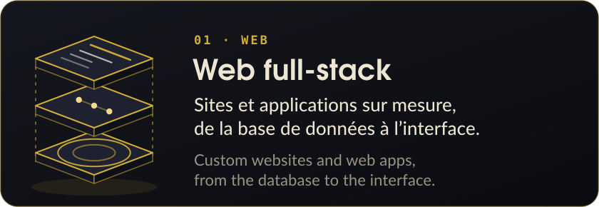

<p align="center">
  
</p>

<p align="center">
  
</p>

<br>

**Bonjour, moi c’est Zerrax.** Je conçois des sites et des applications web sur mesure, de la base de données à l’interface, et je développe des bots pour Discord.

**Hi, I’m Zerrax.** I build custom websites and web apps, from the database to the interface, and I make bots for Discord.

<br>

<p align="center">
  
</p>

<p align="center">
  
</p>

<p align="center">
  
</p>

<br>

### Le monogramme, en 3D · The monogram, in 3D

Cliquez et faites glisser pour le faire tourner. — Click and drag to spin it.

```stl
solid zerrax
facet normal 0.4782 -0.8282 0.2923
outer loop
vertex 6.860 -4.000 -5.870
vertex -0.068 -8.000 -5.870
vertex -0.068 -8.600 -7.570
endloop
endfacet
facet normal -0.0000 -1.0000 -0.0000
outer loop
vertex -4.524 -3.316 -5.401
vertex 4.485 -3.316 -5.401
vertex -1.306 -3.316 -2.847
endloop
endfacet
facet normal 0.0000 -1.0000 0.0000
outer loop
vertex -4.231 -3.317 9.009
vertex -4.231 -3.317 6.454
vertex 0.936 -3.317 6.454
endloop
endfacet
facet normal 0.4782 0.8282 0.2923
outer loop
vertex -0.068 8.000 -5.870
vertex 7.380 4.300 -7.570
vertex -0.068 8.600 -7.570
endloop
endfacet
facet normal 0.0000 -1.0000 -0.0000
outer loop
vertex -4.524 -3.316 -3.139
vertex -4.524 -3.316 -5.401
vertex -1.306 -3.316 -2.847
endloop
endfacet
facet normal -0.4782 -0.8282 0.2923
outer loop
vertex -0.068 -8.000 -5.870
vertex -7.516 -4.300 -7.570
vertex -0.068 -8.600 -7.570
endloop
endfacet
facet normal 0.0000 -1.0000 0.0000
outer loop
vertex 4.114 -3.317 9.009
vertex -4.231 -3.317 9.009
vertex 0.936 -3.317 6.454
endloop
endfacet
facet normal 0.0000 0.0000 1.0000
outer loop
vertex 6.860 -4.000 -5.870
vertex 6.860 4.000 -5.870
vertex -0.068 8.000 -5.870
endloop
endfacet
facet normal 0.0000 -1.0000 0.0000
outer loop
vertex 4.114 -3.317 6.610
vertex 4.114 -3.317 9.009
vertex 0.936 -3.317 6.454
endloop
endfacet
facet normal 0.4782 -0.8282 0.2923
outer loop
vertex 6.860 -4.000 -5.870
vertex -0.068 -8.600 -7.570
vertex 7.380 -4.300 -7.570
endloop
endfacet
facet normal 0.4782 0.8282 0.2923
outer loop
vertex -0.068 8.000 -5.870
vertex 6.860 4.000 -5.870
vertex 7.380 4.300 -7.570
endloop
endfacet
facet normal 0.0000 -1.0000 -0.0000
outer loop
vertex -1.306 -3.316 -2.847
vertex 4.114 -3.317 6.610
vertex 0.936 -3.317 6.454
endloop
endfacet
facet normal 0.0000 -0.0000 1.0000
outer loop
vertex -0.068 8.000 -5.870
vertex -6.996 -4.000 -5.870
vertex 6.860 -4.000 -5.870
endloop
endfacet
facet normal -0.9563 0.0000 0.2923
outer loop
vertex -6.996 -4.000 -5.870
vertex -7.516 4.300 -7.570
vertex -7.516 -4.300 -7.570
endloop
endfacet
facet normal -0.0000 1.0000 0.0000
outer loop
vertex -1.306 3.316 -2.847
vertex -4.524 3.316 -3.139
vertex 0.936 3.316 6.454
endloop
endfacet
facet normal 0.9563 0.0000 0.2923
outer loop
vertex 6.860 4.000 -5.870
vertex 7.380 -4.300 -7.570
vertex 7.380 4.300 -7.570
endloop
endfacet
facet normal 0.0000 0.7071 -0.7071
outer loop
vertex 0.129 2.847 5.985
vertex -4.231 3.316 6.454
vertex 0.936 3.316 6.454
endloop
endfacet
facet normal -0.0000 0.0000 -1.0000
outer loop
vertex -4.700 -2.848 5.985
vertex 0.129 2.847 5.985
vertex 0.129 -2.848 5.985
endloop
endfacet
facet normal 0.0000 -0.7071 -0.7071
outer loop
vertex -4.231 -3.317 6.454
vertex 0.129 -2.848 5.985
vertex 0.936 -3.317 6.454
endloop
endfacet
facet normal -0.7071 0.7071 0.0000
outer loop
vertex -4.700 2.847 9.478
vertex -4.231 3.316 6.454
vertex -4.700 2.847 5.985
endloop
endfacet
facet normal -1.0000 0.0000 0.0000
outer loop
vertex -4.700 -2.848 9.478
vertex -4.700 2.847 5.985
vertex -4.700 -2.848 5.985
endloop
endfacet
facet normal -0.7071 -0.7071 0.0000
outer loop
vertex -4.231 -3.317 9.009
vertex -4.700 -2.848 5.985
vertex -4.231 -3.317 6.454
endloop
endfacet
facet normal -0.0000 0.7071 0.7071
outer loop
vertex -4.700 2.847 9.478
vertex 4.114 3.316 9.009
vertex -4.231 3.316 9.009
endloop
endfacet
facet normal -0.0000 0.0000 1.0000
outer loop
vertex 4.583 -2.848 9.478
vertex -4.700 2.847 9.478
vertex -4.700 -2.848 9.478
endloop
endfacet
facet normal 0.0000 -0.7071 0.7071
outer loop
vertex -4.231 -3.317 9.009
vertex 4.583 -2.848 9.478
vertex -4.700 -2.848 9.478
endloop
endfacet
facet normal 0.7071 0.7071 0.0000
outer loop
vertex 4.583 2.847 6.485
vertex 4.114 3.316 9.009
vertex 4.583 2.847 9.478
endloop
endfacet
facet normal 1.0000 -0.0000 0.0000
outer loop
vertex 4.583 -2.848 6.485
vertex 4.583 2.847 9.478
vertex 4.583 -2.848 9.478
endloop
endfacet
facet normal 0.7071 -0.7071 0.0000
outer loop
vertex 4.114 -3.317 9.009
vertex 4.583 -2.848 6.485
vertex 4.583 -2.848 9.478
endloop
endfacet
facet normal 0.6135 0.7071 -0.3516
outer loop
vertex -0.497 2.847 -2.378
vertex 4.114 3.316 6.610
vertex 4.583 2.847 6.485
endloop
endfacet
facet normal 0.8676 0.0000 -0.4973
outer loop
vertex -0.497 -2.847 -2.378
vertex 4.583 2.847 6.485
vertex 4.583 -2.848 6.485
endloop
endfacet
facet normal 0.6135 -0.7071 -0.3516
outer loop
vertex 4.114 -3.317 6.610
vertex -0.497 -2.847 -2.378
vertex 4.583 -2.848 6.485
endloop
endfacet
facet normal -0.0000 0.7071 0.7071
outer loop
vertex -0.497 2.847 -2.378
vertex 4.485 3.316 -2.847
vertex -1.306 3.316 -2.847
endloop
endfacet
facet normal 0.0000 -0.0000 1.0000
outer loop
vertex 4.954 -2.847 -2.378
vertex -0.497 2.847 -2.378
vertex -0.497 -2.847 -2.378
endloop
endfacet
facet normal 0.0000 -0.7071 0.7071
outer loop
vertex 4.485 -3.316 -2.847
vertex -0.497 -2.847 -2.378
vertex -1.306 -3.316 -2.847
endloop
endfacet
facet normal 0.7071 0.7071 0.0000
outer loop
vertex 4.954 2.847 -2.378
vertex 4.485 3.317 -5.401
vertex 4.485 3.316 -2.847
endloop
endfacet
facet normal 1.0000 -0.0000 0.0000
outer loop
vertex 4.954 -2.847 -5.870
vertex 4.954 2.847 -2.378
vertex 4.954 -2.847 -2.378
endloop
endfacet
facet normal 0.7071 -0.7071 -0.0000
outer loop
vertex 4.485 -3.316 -5.401
vertex 4.954 -2.847 -2.378
vertex 4.485 -3.316 -2.847
endloop
endfacet
facet normal 0.0000 0.7071 -0.7071
outer loop
vertex -4.993 2.848 -5.870
vertex 4.485 3.317 -5.401
vertex 4.954 2.848 -5.870
endloop
endfacet
facet normal -0.0000 0.0000 -1.0000
outer loop
vertex -4.993 -2.847 -5.870
vertex 4.954 2.848 -5.870
vertex 4.954 -2.847 -5.870
endloop
endfacet
facet normal -0.0000 -0.7071 -0.7071
outer loop
vertex 4.485 -3.316 -5.401
vertex -4.993 -2.847 -5.870
vertex 4.954 -2.847 -5.870
endloop
endfacet
facet normal -0.7071 0.7071 0.0000
outer loop
vertex -4.993 2.847 -3.015
vertex -4.524 3.317 -5.401
vertex -4.993 2.848 -5.870
endloop
endfacet
facet normal -1.0000 -0.0000 0.0000
outer loop
vertex -4.993 -2.847 -5.870
vertex -4.993 2.847 -3.015
vertex -4.993 2.848 -5.870
endloop
endfacet
facet normal -0.7071 -0.7071 -0.0000
outer loop
vertex -4.524 -3.316 -5.401
vertex -4.993 -2.847 -3.015
vertex -4.993 -2.847 -5.870
endloop
endfacet
facet normal -0.6146 0.7071 0.3497
outer loop
vertex 0.129 2.847 5.985
vertex -4.524 3.316 -3.139
vertex -4.993 2.847 -3.015
endloop
endfacet
facet normal -0.8691 0.0000 0.4946
outer loop
vertex -4.993 -2.847 -3.015
vertex 0.129 2.847 5.985
vertex -4.993 2.847 -3.015
endloop
endfacet
facet normal -0.6146 -0.7071 0.3497
outer loop
vertex -4.524 -3.316 -3.139
vertex 0.129 -2.848 5.985
vertex -4.993 -2.847 -3.015
endloop
endfacet
facet normal 0.0000 -1.0000 -0.0000
outer loop
vertex 4.485 -3.316 -5.401
vertex 4.485 -3.316 -2.847
vertex -1.306 -3.316 -2.847
endloop
endfacet
facet normal -0.4782 -0.8282 0.2923
outer loop
vertex -0.068 -8.000 -5.870
vertex -6.996 -4.000 -5.870
vertex -7.516 -4.300 -7.570
endloop
endfacet
facet normal 0.0000 -1.0000 -0.0000
outer loop
vertex 0.936 -3.317 6.454
vertex -4.524 -3.316 -3.139
vertex -1.306 -3.316 -2.847
endloop
endfacet
facet normal -0.4782 0.8282 0.2923
outer loop
vertex -6.996 4.000 -5.870
vertex -0.068 8.600 -7.570
vertex -7.516 4.300 -7.570
endloop
endfacet
facet normal 0.0000 0.0000 -1.0000
outer loop
vertex 7.380 4.300 -7.570
vertex -0.068 -8.600 -7.570
vertex -7.516 4.300 -7.570
endloop
endfacet
facet normal 0.0000 0.0000 1.0000
outer loop
vertex -0.068 8.000 -5.870
vertex -6.996 4.000 -5.870
vertex -6.996 -4.000 -5.870
endloop
endfacet
facet normal 0.0000 0.0000 1.0000
outer loop
vertex -6.996 -4.000 -5.870
vertex -0.068 -8.000 -5.870
vertex 6.860 -4.000 -5.870
endloop
endfacet
facet normal -0.9563 0.0000 0.2923
outer loop
vertex -6.996 -4.000 -5.870
vertex -6.996 4.000 -5.870
vertex -7.516 4.300 -7.570
endloop
endfacet
facet normal 0.0000 1.0000 0.0000
outer loop
vertex -1.306 3.316 -2.847
vertex 4.485 3.316 -2.847
vertex 4.485 3.317 -5.401
endloop
endfacet
facet normal -0.0000 1.0000 0.0000
outer loop
vertex 4.485 3.317 -5.401
vertex -4.524 3.317 -5.401
vertex -1.306 3.316 -2.847
endloop
endfacet
facet normal -0.0000 1.0000 0.0000
outer loop
vertex -4.524 3.317 -5.401
vertex -4.524 3.316 -3.139
vertex -1.306 3.316 -2.847
endloop
endfacet
facet normal -0.0000 1.0000 0.0000
outer loop
vertex 0.936 3.316 6.454
vertex -4.231 3.316 6.454
vertex -4.231 3.316 9.009
endloop
endfacet
facet normal 0.0000 1.0000 0.0000
outer loop
vertex 4.114 3.316 9.009
vertex 4.114 3.316 6.610
vertex 0.936 3.316 6.454
endloop
endfacet
facet normal -0.0000 1.0000 0.0000
outer loop
vertex 4.114 3.316 6.610
vertex -1.306 3.316 -2.847
vertex 0.936 3.316 6.454
endloop
endfacet
facet normal 0.0000 1.0000 0.0000
outer loop
vertex 0.936 3.316 6.454
vertex -4.231 3.316 9.009
vertex 4.114 3.316 9.009
endloop
endfacet
facet normal 0.9563 -0.0000 0.2923
outer loop
vertex 6.860 4.000 -5.870
vertex 6.860 -4.000 -5.870
vertex 7.380 -4.300 -7.570
endloop
endfacet
facet normal 0.0000 0.7071 -0.7071
outer loop
vertex 0.129 2.847 5.985
vertex -4.700 2.847 5.985
vertex -4.231 3.316 6.454
endloop
endfacet
facet normal -0.0000 -0.0000 -1.0000
outer loop
vertex -4.700 -2.848 5.985
vertex -4.700 2.847 5.985
vertex 0.129 2.847 5.985
endloop
endfacet
facet normal -0.0000 -0.7071 -0.7071
outer loop
vertex -4.231 -3.317 6.454
vertex -4.700 -2.848 5.985
vertex 0.129 -2.848 5.985
endloop
endfacet
facet normal -0.7071 0.7071 0.0000
outer loop
vertex -4.700 2.847 9.478
vertex -4.231 3.316 9.009
vertex -4.231 3.316 6.454
endloop
endfacet
facet normal -1.0000 0.0000 0.0000
outer loop
vertex -4.700 -2.848 9.478
vertex -4.700 2.847 9.478
vertex -4.700 2.847 5.985
endloop
endfacet
facet normal -0.7071 -0.7071 0.0000
outer loop
vertex -4.231 -3.317 9.009
vertex -4.700 -2.848 9.478
vertex -4.700 -2.848 5.985
endloop
endfacet
facet normal 0.0000 0.7071 0.7071
outer loop
vertex -4.700 2.847 9.478
vertex 4.583 2.847 9.478
vertex 4.114 3.316 9.009
endloop
endfacet
facet normal -0.0000 0.0000 1.0000
outer loop
vertex 4.583 -2.848 9.478
vertex 4.583 2.847 9.478
vertex -4.700 2.847 9.478
endloop
endfacet
facet normal 0.0000 -0.7071 0.7071
outer loop
vertex -4.231 -3.317 9.009
vertex 4.114 -3.317 9.009
vertex 4.583 -2.848 9.478
endloop
endfacet
facet normal 0.7071 0.7071 0.0000
outer loop
vertex 4.583 2.847 6.485
vertex 4.114 3.316 6.610
vertex 4.114 3.316 9.009
endloop
endfacet
facet normal 1.0000 0.0000 0.0000
outer loop
vertex 4.583 -2.848 6.485
vertex 4.583 2.847 6.485
vertex 4.583 2.847 9.478
endloop
endfacet
facet normal 0.7071 -0.7071 0.0000
outer loop
vertex 4.114 -3.317 9.009
vertex 4.114 -3.317 6.610
vertex 4.583 -2.848 6.485
endloop
endfacet
facet normal 0.6135 0.7071 -0.3516
outer loop
vertex -0.497 2.847 -2.378
vertex -1.306 3.316 -2.847
vertex 4.114 3.316 6.610
endloop
endfacet
facet normal 0.8676 0.0000 -0.4973
outer loop
vertex -0.497 -2.847 -2.378
vertex -0.497 2.847 -2.378
vertex 4.583 2.847 6.485
endloop
endfacet
facet normal 0.6135 -0.7071 -0.3516
outer loop
vertex 4.114 -3.317 6.610
vertex -1.306 -3.316 -2.847
vertex -0.497 -2.847 -2.378
endloop
endfacet
facet normal 0.0000 0.7071 0.7071
outer loop
vertex -0.497 2.847 -2.378
vertex 4.954 2.847 -2.378
vertex 4.485 3.316 -2.847
endloop
endfacet
facet normal 0.0000 -0.0000 1.0000
outer loop
vertex 4.954 -2.847 -2.378
vertex 4.954 2.847 -2.378
vertex -0.497 2.847 -2.378
endloop
endfacet
facet normal 0.0000 -0.7071 0.7071
outer loop
vertex 4.485 -3.316 -2.847
vertex 4.954 -2.847 -2.378
vertex -0.497 -2.847 -2.378
endloop
endfacet
facet normal 0.7071 0.7071 0.0000
outer loop
vertex 4.954 2.847 -2.378
vertex 4.954 2.848 -5.870
vertex 4.485 3.317 -5.401
endloop
endfacet
facet normal 1.0000 0.0000 0.0000
outer loop
vertex 4.954 -2.847 -5.870
vertex 4.954 2.848 -5.870
vertex 4.954 2.847 -2.378
endloop
endfacet
facet normal 0.7071 -0.7071 -0.0000
outer loop
vertex 4.485 -3.316 -5.401
vertex 4.954 -2.847 -5.870
vertex 4.954 -2.847 -2.378
endloop
endfacet
facet normal 0.0000 0.7071 -0.7071
outer loop
vertex -4.993 2.848 -5.870
vertex -4.524 3.317 -5.401
vertex 4.485 3.317 -5.401
endloop
endfacet
facet normal -0.0000 -0.0000 -1.0000
outer loop
vertex -4.993 -2.847 -5.870
vertex -4.993 2.848 -5.870
vertex 4.954 2.848 -5.870
endloop
endfacet
facet normal 0.0000 -0.7071 -0.7071
outer loop
vertex 4.485 -3.316 -5.401
vertex -4.524 -3.316 -5.401
vertex -4.993 -2.847 -5.870
endloop
endfacet
facet normal -0.7071 0.7071 0.0000
outer loop
vertex -4.993 2.847 -3.015
vertex -4.524 3.316 -3.139
vertex -4.524 3.317 -5.401
endloop
endfacet
facet normal -1.0000 -0.0000 -0.0000
outer loop
vertex -4.993 -2.847 -5.870
vertex -4.993 -2.847 -3.015
vertex -4.993 2.847 -3.015
endloop
endfacet
facet normal -0.7071 -0.7071 -0.0000
outer loop
vertex -4.524 -3.316 -5.401
vertex -4.524 -3.316 -3.139
vertex -4.993 -2.847 -3.015
endloop
endfacet
facet normal -0.6146 0.7071 0.3497
outer loop
vertex 0.129 2.847 5.985
vertex 0.936 3.316 6.454
vertex -4.524 3.316 -3.139
endloop
endfacet
facet normal -0.8691 0.0000 0.4946
outer loop
vertex -4.993 -2.847 -3.015
vertex 0.129 -2.848 5.985
vertex 0.129 2.847 5.985
endloop
endfacet
facet normal -0.6146 -0.7071 0.3497
outer loop
vertex -4.524 -3.316 -3.139
vertex 0.936 -3.317 6.454
vertex 0.129 -2.848 5.985
endloop
endfacet
facet normal -0.4782 0.8282 0.2923
outer loop
vertex -6.996 4.000 -5.870
vertex -0.068 8.000 -5.870
vertex -0.068 8.600 -7.570
endloop
endfacet
facet normal -0.0000 0.0000 -1.0000
outer loop
vertex -7.516 4.300 -7.570
vertex -0.068 8.600 -7.570
vertex 7.380 4.300 -7.570
endloop
endfacet
facet normal 0.0000 0.0000 -1.0000
outer loop
vertex 7.380 4.300 -7.570
vertex 7.380 -4.300 -7.570
vertex -0.068 -8.600 -7.570
endloop
endfacet
facet normal 0.0000 0.0000 -1.0000
outer loop
vertex -0.068 -8.600 -7.570
vertex -7.516 -4.300 -7.570
vertex -7.516 4.300 -7.570
endloop
endfacet
endsolid zerrax
```

<p align="center">
  
</p>
